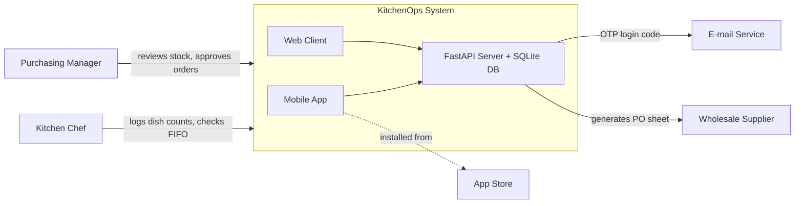

# Project Proposal

**AI-Assisted Software Development · Atlas University · Fall 2026–2027**

| | |
|---|---|
| **Student** | 220504045 · Anıl · Aydeniz |
| **Section** | en |
| **Project** | KitchenOps — commercial kitchen inventory depletion and smart restock logistics |

---

## Part A — What you will build (Week 2)

### 1. Title (about 80 characters)
KitchenOps — commercial kitchen inventory depletion and smart restock logistics

### 2. One-paragraph summary (about 400 characters)
KitchenOps is a mobile and web application for commercial restaurant and cafe kitchens that eliminates ingredient shortages and food spoilage through automated inventory logistics. It automatically deducts raw ingredient stocks whenever dishes are prepared based on standard recipe bills of materials, enforces FIFO batch rotation for expiring fresh goods, and generates instant purchase orders for wholesale suppliers when ingredient levels fall below safety thresholds. Kitchen managers track real-time food cost and waste analytics directly from the web dashboard.

### 3. Problem (about 600 characters)
Medium-sized commercial restaurants and cafes serving 150 to 400 covers daily lose 8% to 12% of their monthly revenue to food spoilage, unrecorded recipe over-portioning, and emergency stockouts. Today, head chefs conduct late-night inventory counts with clipboards and send informal WhatsApp voice notes to wholesale suppliers at 23:30. In 20 restaurants surveyed in the local dining district, kitchen staff consistently opened newly delivered crates of dairy and produce while older batches sat unnoticed at the back of the walk-in cooler until spoiled. When a critical ingredient like cooking cream or chicken breast runs out during peak dinner service, line cooks scramble to buy retail-priced substitutes from nearby grocery markets at a 40% premium, or 86 menu items altogether, resulting in dissatisfied patrons and wasted payroll.

### 4. Solution (about 600 characters)
KitchenOps replaces clipboard guesswork with an integrated inventory and supply chain engine. The kitchen chef logs daily prepared dish counts with one tap on mobile, and the server automatically deducts raw ingredients from the central walk-in stock based on calibrated recipe portion formulas. The system assigns batch dates to inbound crates, prioritizing older inventory using strict First-In, First-Out (FIFO) cues to prevent expiration waste. When any critical stock drops below its defined minimum threshold, KitchenOps automatically compiles an itemized wholesale supplier procurement sheet ready for one-click manager dispatch. Restaurant managers view daily ingredient burn rates, food waste metrics, and supplier costs on the web dashboard. KitchenOps deliberately does NOT process customer POS dining payments, handle kitchen display ticket routing, or manage delivery courier dispatch.

### 5. How it works (about 600 characters + one diagram)
Kitchen chefs and stockroom receivers use the mobile app to record ingredient deliveries, verify batch expiry dates, and log completed dish counts during prep service. Restaurant owners and purchasing managers use the web client to inspect real-time pantry inventory, configure recipe portion ratios, adjust safety thresholds, and approve wholesale supplier purchase orders. The server runs on FastAPI with SQLite, maintaining recipe bills of materials, ingredient stock levels, and automated replenishment queues while running a background scheduler that flags expiring batches every midnight. Kitchen staff authenticate securely using an OTP verification code sent via e-mail. Both mobile and web clients communicate exclusively through the server's REST API. No internal AI model runs in the base loop; lightweight recipe optimization advice runs on the server.

### 6. Technologies (about 300 characters)
Mobile: React Native with Expo (hybrid, Android/iOS ready). Web: Streamlit (Python 3.13 dashboard). Server: FastAPI (Python 3.13 REST backend). Database: SQLite (local relational store). Login e-mail: Resend / SMTP OTP service. Hosting: Render (free tier backend). Store: Google Play Store. AI: rule-based inventory optimization; future recipe adaptation via Claude API.

### 7. Success criteria (about 400 characters)
1. A kitchen chef logs 30 prepared pasta portions on the mobile app, and the server correctly deducts 3.6 kg pasta and 2.4 kg sauce from stock in under two seconds.
2. When ingredient stock drops below its safety threshold, an itemized supplier procurement order appears on the purchasing manager's web dashboard within three seconds.
3. In a five-day beta trial with two cafe test kitchens, zero critical ingredients run out during lunch service without an advance replenishment alert.
4. The FIFO batch tracker successfully flags perishable dairy items 48 hours before expiration with 100% notification accuracy.

---

## Part B — Why it is worth building (Week 3)

### 8. Market and target users (about 500 characters)
First users are the five testers named in slide 3 (Emre Yılmaz, Caner Aksoy, Burak Demir, Selin Kaya, Mert Öztürk), representing neighborhood cafes, burger bistros, and campus catering kitchens in Istanbul. In Istanbul alone, there are over 18,000 independent food & beverage establishments (TÜİK / İTO 2025). I surveyed 20 restaurant and cafe kitchens across Kadıköy and Kağıthane in September 2026: 18 rely on manual clipboard inspections or night WhatsApp messages to suppliers, and 16 experienced at least one emergency ingredient stockout during service in the preceding two weeks. KitchenOps targets small-to-medium independent kitchens (100–350 daily covers) with 3 to 10 kitchen staff who lack dedicated inventory ERP software.

### 9. Competitors (about 500 characters)
1. Clipboard & Whiteboard Log — Free, universally understood, but completely disconnected from wholesale suppliers, prone to unrecorded portioning, and provides zero automated FIFO expiration warnings.
2. Excel Spreadsheets & WhatsApp Messages — Free and flexible, but requires tedious late-night manual data entry after 12-hour kitchen shifts; nobody updates ingredient counts during live cooking rushes.
3. Enterprise Restaurant ERP / POS Add-ons (e.g., Simpra, SambaPOS Pro, Toast) — Powerful all-in-one systems, but cost over 30,000 TL setup plus 1,500 TL/month, require complex hardware and accounting training, and are over-engineered for lean kitchen line crews who just need stock depletion and restock orders.

### 10. Comparison and your advantage (about 500 characters)
| Solution | Real-time prep depletion | FIFO spoilage alert | Auto supplier PO | Setup cost & barrier |
|---|---|---|---|---|
| Clipboard / Whiteboard | No | No | No | Free / zero barrier |
| Excel & WhatsApp | No (delayed) | No | No | Free / high friction |
| Enterprise Restaurant ERP | Yes (complex) | Partial | Yes | >30,000 TL + training |
| **KitchenOps** | **Yes (1-tap mobile)** | **Yes (48h auto)** | **Yes (one-click)** | **Free tier / 5 min setup** |

KitchenOps is the only focused inventory tool built for kitchen line staff that auto-depletes stock upon dish preparation and warns of expiring batches, without requiring expensive POS hardware replacement or accounting overhead.

### 11. Commercial potential (about 400 characters)
Free core tier for single-station kitchens (up to 30 inventory items and 10 daily recipes), sufficient for small cafes and campus test kitchens. Commercial Pro tier offered at 350 TL (~10 €) per month per branch for multi-station kitchens, automated supplier dispatch, and waste analytics. Cloud hosting on Render and Supabase SQLite/PostgreSQL costs approximately 7 € monthly. A medium bistro loses over 4,000 TL monthly in food waste and emergency retail grocery purchases; saving just one emergency run pays for the monthly subscription.

### 12. Technical risks and how you will manage them (about 600 characters)
1. Store: Google Play Store (25 $ one-time registration fee). Google Play requires a closed test with at least 12 testers opted-in for 14 continuous days for new personal developer accounts; therefore, the closed test track will be launched in Week 8 with the 5 designated testers and 7 classmates to comfortably meet the Week 11 deadline. Fallback: Huawei AppGallery (free registration, 3-day review cycle) or direct APK release.
2. Free hosting cold starts: Render web services sleep after 15 minutes of inactivity, causing a 45-second latency on the first morning request. Mitigation: A lightweight GitHub Actions cron ping runs every 10 minutes between 08:00 and 23:00 during active kitchen service hours.
3. Dirty or wet kitchen environments: Kitchen staff have wet or greasy hands during prep shifts and cannot type lengthy ingredient names. Mitigation: High-contrast 48px touch targets, numerical keypad counters for dish counts, and mobile camera barcode scanning for incoming crate check-in. Fallback: quick 3-digit recipe shortcuts.

---

## Change log
- 2026-10-06 — §4: added aggregate prep batch depletion mode and manager approval workflow based on peer review from 220504024 and 220504031.
- 2026-10-10 — §4, §10, §12: automated oldest-batch FIFO consumption by default to prevent kitchen staff manual selection friction during peak hours, prompted by investor AI objection.
