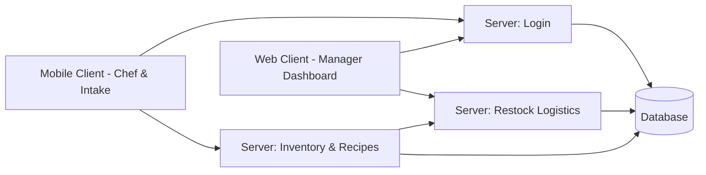

# KitchenOps — commercial kitchen inventory depletion and smart restock logistics

## Components

| Component | What it does | REQ |
|---|---|---|
| Server: login | Sends a 4-digit code to an e-mail address, checks it and issues a session token | REQ-001 |
| Server: inventory & recipes | Depletes raw ingredient stocks based on recipe bills of materials when dish preparations are logged | REQ-002, REQ-004 |
| Server: restock logistics | Monitors ingredient safety thresholds and appends required replenishment quantities to pending supplier purchase orders | REQ-003, REQ-005 |
| Database | Stores user credentials, recipe formulations, active stock counts, FIFO batch tags, and supplier purchase orders | REQ-001, REQ-002, REQ-003, REQ-004, REQ-005 |
| Mobile client | Provides kitchen staff with responsive dish preparation logging, inbound receiving intake, and FIFO batch inspection | REQ-002, REQ-004, REQ-005, REQ-006 |
| Web client | Provides restaurant managers with live inventory monitoring, consumption audit trails, and supplier purchase order dispatch | REQ-003, REQ-006, REQ-007 |

## Architecture

