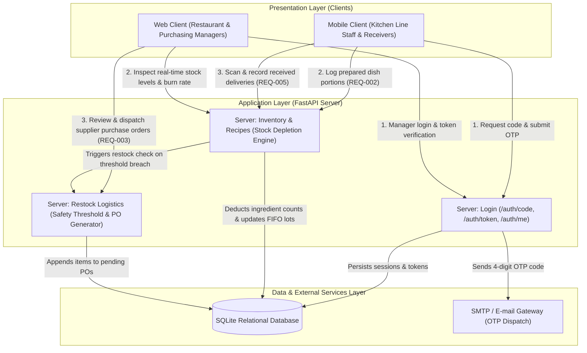

# KitchenOps — commercial kitchen inventory depletion and smart restock logistics

## Components

| Component | What it does | REQ |
|---|---|---|
| Server: login | Sends a 4-digit code to an e-mail address, checks it and issues a session token | REQ-001 |
| Server: inventory & recipes | Depletes raw ingredient stocks based on recipe bills of materials when dish preparations are logged | REQ-002, REQ-004 |
| Server: restock logistics | Monitors ingredient safety thresholds and appends required replenishment quantities to pending supplier purchase orders | REQ-003, REQ-005 |
| Database | Stores user credentials, recipe formulations, active stock counts, FIFO batch tags, and supplier purchase orders | REQ-001, REQ-002, REQ-003, REQ-004, REQ-005 |
| Mobile client | Provides kitchen staff with responsive dish preparation logging, inbound receiving intake, and FIFO batch inspection | REQ-002, REQ-004, REQ-005, REQ-006 |
| Web client | Provides restaurant managers with live inventory monitoring, consumption audit trails, and supplier purchase order dispatch | REQ-003, REQ-006, REQ-007 |

## Architecture

## Component Responsibilities and Interface Contracts

### 1. Server: Login (`server/routes/auth.py` / `server/main.py`)
* **Responsibility:** Implements passwordless authentication under REQ-001. Dispatches temporary 4-digit verification codes to authorized restaurant personnel e-mail addresses, verifies submitted OTP codes within a 10-minute validity window, and issues Bearer session tokens.
* **Interfaces:** `POST /auth/code`, `POST /auth/token`, `GET /auth/me`.
* **Security Constraints:** Rate limits code requests to 1 request per minute (HTTP 429), strictly avoids storing plain passwords, and rejects expired codes with HTTP 401.

### 2. Server: Inventory & Recipes (`server/routes/inventory.py`)
* **Responsibility:** Houses the core Bill of Materials (BOM) stock depletion calculation engine under REQ-002 and REQ-004. When line chefs confirm dish completion on mobile, it calculates component ingredient weights, resolves active FIFO lot batches, and deducts the appropriate quantities in an atomic transaction.
* **FIFO Logic:** Perishable ingredients draw sequentially from the oldest unexpired lot to prevent kitchen spoilage waste. Emits audit logs with timestamp, operator ID, and exact depleted quantities.

### 3. Server: Restock Logistics (`server/routes/restock.py`)
* **Responsibility:** Continuously evaluates inventory levels against configured safety thresholds under REQ-003 and REQ-005. When an ingredient's count falls below safety minimums (e.g., cooking cream dropping below 5 liters), it automatically appends calculated reorder increments (e.g., +20 liters) to the pending wholesale supplier purchase order sheet.
* **Supplier Dispatch:** Aggregates restock entries into itemized purchase orders for single-click manager approval and wholesale email dispatch.

### 4. Database Layer (SQLite Relational Store)
* **Tables:** `users`, `ingredients`, `recipes`, `recipe_items`, `inventory_lots`, `purchase_orders`, `purchase_order_items`, `audit_logs`.
* **Integrity:** Enforces foreign key constraints between recipe formulations and ingredient catalog entries. Tracks lot creation dates, physical storage shelf locations (e.g., Walk-in Chiller A, Shelf B-03), and expiration timestamps.

### 5. Mobile Client (React Native with Expo)
* **Target Viewport:** Calibrated for mobile screens approximately 390 px wide under REQ-006.
* **Usage Context:** Designed for high-tempo kitchen environments with high-contrast UI, minimum 48 px touch targets, and offline-resilient prep completion queues.

### 6. Web Client (Streamlit / Modern Web)
* **Target Viewport:** Desktop and tablet dashboards for restaurant managers.
* **Usage Context:** Provides real-time visual pantry status, consumption analytics, recipe margin breakdowns, and supplier PO dispatch workflows under REQ-007.
