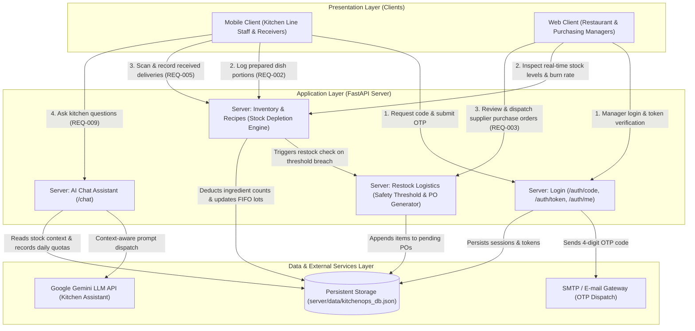

# KitchenOps — commercial kitchen inventory depletion and smart restock logistics

## Components

| Component | What it does | REQ |
|---|---|---|
| Server: login | Sends a 4-digit code to an e-mail address, checks it and issues a session token | REQ-001 |
| Server: inventory & recipes | Depletes raw ingredient stocks based on recipe bills of materials when dish preparations are logged | REQ-002, REQ-004 |
| Server: restock logistics | Monitors ingredient safety thresholds and appends required replenishment quantities to pending supplier purchase orders | REQ-003, REQ-005 |
| Server: AI chat | Answers chef pantry queries via Google Gemini API with low-stock alerts, recipes and 20 msg/day quota | REQ-009 |
| Database & storage | Stores user credentials, active stock counts, supplier purchase orders and chat quotas in server/data/kitchenops_db.json | REQ-001, REQ-002, REQ-003, REQ-004, REQ-005, REQ-009 |
| Mobile client | Provides kitchen staff with responsive dish preparation logging, inbound receiving intake, FIFO batch inspection and AI chat | REQ-002, REQ-004, REQ-005, REQ-006, REQ-009 |
| Web client | Provides restaurant managers with live inventory monitoring, consumption audit trails, and supplier purchase order dispatch | REQ-003, REQ-006, REQ-007 |

## Architecture

## Component Responsibilities and Interface Contracts

### 1. Server: Login (`server/routes/auth.py` / `server/main.py`)
* **Responsibility:** Implements passwordless authentication under REQ-001. Dispatches temporary 4-digit verification codes to authorized restaurant personnel e-mail addresses, verifies submitted OTP codes within a 10-minute validity window, and issues Bearer session tokens.
* **Interfaces:** `POST /auth/code`, `POST /auth/token`, `GET /auth/me`.
* **Security Constraints:** Rate limits code requests to 1 request per minute (HTTP 429), strictly avoids storing plain passwords, and rejects expired codes with HTTP 401.

### 2. Server: Inventory & Recipes (`server/prep.py`)
* **Responsibility:** Houses the core Bill of Materials (BOM) stock depletion calculation engine under REQ-002 and REQ-004. When line chefs confirm dish completion on mobile, it calculates component ingredient weights, resolves active FIFO lot batches, and deducts the appropriate quantities in an atomic transaction.
* **FIFO Logic:** Perishable ingredients draw sequentially from the oldest unexpired lot to prevent kitchen spoilage waste. Emits audit logs with timestamp, operator ID, and exact depleted quantities.

### 3. Server: Restock Logistics (`server/orders.py`)
* **Responsibility:** Continuously evaluates inventory levels against configured safety thresholds under REQ-003 and REQ-005. When an ingredient's count falls below safety minimums (e.g., cooking cream dropping below 5 liters), it automatically appends calculated reorder increments (e.g., +20 liters) to the pending wholesale supplier purchase order sheet.
* **Supplier Dispatch:** Aggregates restock entries into itemized purchase orders for single-click manager approval and wholesale email dispatch.

### 4. Server: AI Chat Assistant (`server/chat.py`)
* **Responsibility:** Implements the conversational kitchen assistant under REQ-009. Answers chef queries with current pantry levels, low-stock warnings, and recipe formulations using Google Gemini REST API.
* **Security and Quota:** Requires authenticated Bearer token (HTTP 401), limits each chef to 20 messages per calendar day (HTTP 429), isolates prompts to authenticated user context only, and handles upstream LLM failures with HTTP 503 within a strict 20-second timeout.

### 5. Server: Data Persistence Across Restarts (§5.2)
* **Persistent Storage File:** Server data persists across server process restarts in `server/data/kitchenops_db.json` (ingredient stock inventory, active purchase orders, and daily chat quota counters).

### 6. Mobile Client (`mobile/`)
* **Target Viewport:** Calibrated for mobile screens approximately 390 px wide under REQ-006.
* **Screens:** `LoginScreen.js` (REQ-001), `PrepScreen.js` (REQ-002), `OrderScreen.js` (REQ-003), and `ChatScreen.js` (REQ-009) with tab navigation.

### 7. Web Client (`web/`)
* **Target Viewport:** Desktop and tablet dashboards for restaurant managers.
* **Usage Context:** Provides real-time visual pantry status, consumption analytics, recipe margin breakdowns, and supplier PO dispatch workflows under REQ-007.
